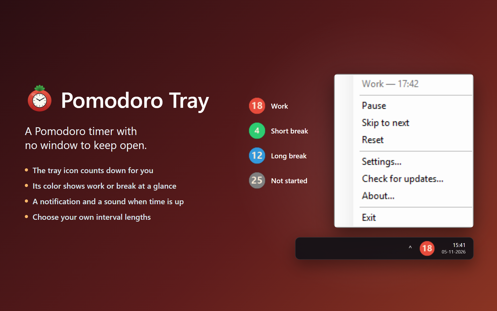

# Pomodoro Tray

[](https://github.com/kreaton/PomodoroTray/releases/latest)
[](LICENSE)




**A Pomodoro timer that lives in the Windows notification area.**

There's no window to keep open: the tray icon counts down for you and tells you when it's time for a break.

## Install

**[Download the installer](https://github.com/kreaton/PomodoroTray/releases/latest/download/PomodoroTray-win-Setup.exe)** and run it. If your PC doesn't have the .NET 10 Desktop Runtime yet, the installer adds it.

The installer isn't code-signed, so Windows may warn you about it. To continue, choose **More info → Run anyway**.

Windows may hide new tray icons behind the **^** arrow on the taskbar. Drag the icon out onto the taskbar to keep it in view.

To get a newer version later, right-click the icon and choose **Check for updates...**. To remove the app, use **Settings → Apps → Installed apps** in Windows.

## How to use it

Double-click the tray icon to start or pause the timer. Right-click it for everything else: the current status, **Start/Pause**, **Skip to next**, **Reset**, **Settings...**, **About...** and **Exit**.

The icon shows the minutes left, and the seconds during the final minute. Its color tells you where you are:

| Color | Meaning |
|---|---|
| Red | Work |
| Green | Short break |
| Blue | Long break |
| Gray | Not started |

When an interval ends, a notification and a sound tell you what's next, and the next interval starts by itself. After a set number of work sessions, you get a long break instead of a short one.

## Settings

Right-click the icon and choose **Settings...**.

| Setting | Default |
|---|---|
| Work interval | 25 minutes |
| Short break | 5 minutes |
| Long break | 15 minutes |
| Work sessions before a long break | 4 |
| Automatically start the next interval | On |
| Play a sound when an interval ends | On |
| Start automatically when Windows starts | Your choice |

---

## For developers

The app is built with WinForms on .NET 10 and only runs on Windows. Installs and updates use [Velopack](https://velopack.io). Settings are saved to `%AppData%\PomodoroTray\settings.json`.

### Build and run

You need the [.NET 10 SDK](https://dotnet.microsoft.com/download). You can also open `PomodoroTray.slnx` in Visual Studio and press F5.

```bash
dotnet run --project PomodoroTray
```

### Releases

Every push to `main` builds the app on GitHub Actions and publishes a new release, one patch version higher than the last (`.github/workflows/release.yml`). To push without releasing, add `[skip ci]` to the commit message. You can also start a release by hand from the repository's Actions tab, or run `PomodoroTray\BuildRelease.ps1` locally. Add `-LocalOnly` to build without uploading.

The repository must stay public, because **Check for updates...** reads its releases without logging in.

### Source files

All of these are in the `PomodoroTray` folder.

- `Program.cs`: entry point, starts the tray application
- `TrayApplicationContext.cs`: timer logic, tray icon, menu, updates and the countdown badge
- `SettingsForm.cs`: settings dialog
- `AboutForm.cs`: about dialog
- `PomodoroSettings.cs`: settings, loaded from and saved to JSON
- `PomodoroPhases.cs`: the work and break phases
- `AutoStartManager.cs`: the "start with Windows" option
