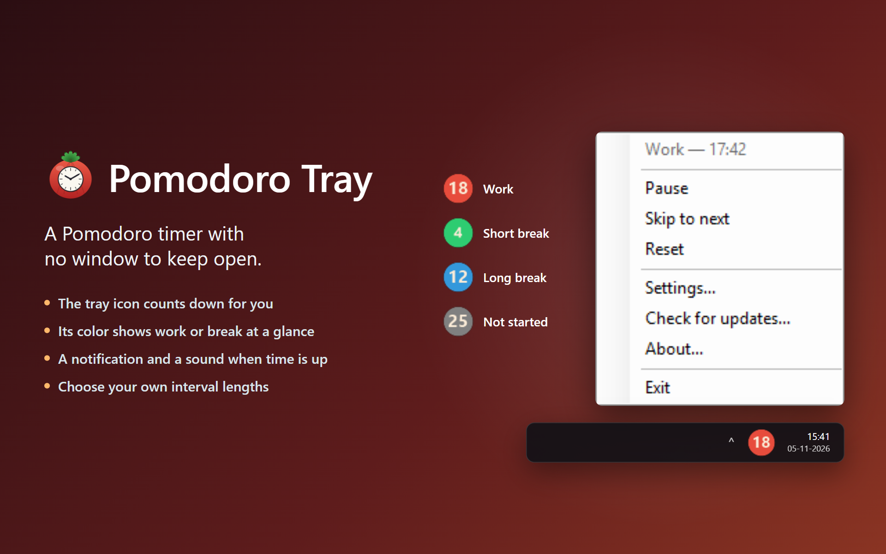

# Pomodoro Tray

[](https://github.com/kreaton/PomodoroTray/releases/latest)
[](LICENSE)


[](https://github.com/kreaton/PomodoroTray/stargazers)

⭐ If Pomodoro Tray earns a place on your machine, [star it on GitHub](https://github.com/kreaton/PomodoroTray) — it's free, made by one developer, and stars are how other people find it.



**A Pomodoro timer that lives in the Windows notification area.**

There's no window to keep open: the tray icon counts down for you and tells you when it's time for a break.

## Install

**[Download the installer](https://github.com/kreaton/PomodoroTray/releases/latest/download/PomodoroTray-win-Setup.exe)** and run it. If your PC doesn't have the .NET 10 Desktop Runtime yet, the installer adds it.

The installer isn't code-signed, so Windows may warn you about it. To continue, choose **More info → Run anyway**.

Windows may hide new tray icons behind the **^** arrow on the taskbar. Drag the icon out onto the taskbar to keep it in view.

To get a newer version later, right-click the icon and choose **Check for updates...**. To remove the app, use **Settings → Apps → Installed apps** in Windows.

## How to use it

Double-click the tray icon to start or pause the timer. Right-click it for everything else: the current status, **Start/Pause**, **Skip to next**, **Reset**, **Settings...**, **Check for updates...**, **About...** and **Exit**.

The icon shows the minutes left, rounded up, and the seconds during the final minute. Hover over it to see the exact time left. Its color tells you where you are:

| Color | Meaning |
|---|---|
| Red | Work |
| Green | Short break |
| Blue | Long break |
| Gray | Not started, or reset |

When an interval ends, a sound plays, and if you've turned it on in Settings, a notification tells you what's next. The next interval then starts by itself, unless you've turned that off in Settings. After a set number of work sessions, you get a long break instead of a short one.

- **Skip to next** ends the current interval right away, just as if its time had run out. A skipped work interval still counts toward the long break.
- **Reset** stops the timer and sets it back to a full work interval.

## Settings

Right-click the icon and choose **Settings...**.

| Setting | Default | Range |
|---|---|---|
| Work interval | 25 minutes | 1 to 180 minutes |
| Short break | 5 minutes | 1 to 60 minutes |
| Long break | 15 minutes | 1 to 90 minutes |
| Work sessions before a long break | 4 | 1 to 12 |
| Automatically start the next interval | On | |
| Show a notification when an interval ends | Off | |
| Start automatically when Windows starts | Off | |
| Play a sound when an interval ends | On | |
| Transition sounds: work → short break, work → long break, break → work | Windows default sound | The Windows default, a sound that comes with the app, or any `.wav` file |

To pick a sound, open the dropdown next to a transition. It lists the Windows default sound and the sounds that come with the app: chimes, and spoken announcements in a man's and a woman's voice (generated with [TTSMaker](https://ttsmaker.com); see [THIRD-PARTY-NOTICES.md](THIRD-PARTY-NOTICES.md)). To use a sound of your own, click **...** and choose a `.wav` file; the file picker opens in the folder you last picked from. **▶** plays the selected sound. If a chosen file is moved or can't be played, the default sound plays instead.

While the timer is running, new interval lengths apply from the next interval. If it's paused or not started, the current interval starts over with its new length.

---

## For developers

The app is built with WinForms on .NET 10 and only runs on Windows. Installs and updates use [Velopack](https://velopack.io). Settings are saved to `%AppData%\PomodoroTray\settings.json`. The "start with Windows" option isn't in that file: it's a `PomodoroTray` value under `HKEY_CURRENT_USER\Software\Microsoft\Windows\CurrentVersion\Run`.

### Build and run

You need the [.NET 10 SDK](https://dotnet.microsoft.com/download). You can also open `PomodoroTray.slnx` in Visual Studio and press F5.

```bash
dotnet run --project PomodoroTray
```

### Releases

Every push to `main` builds the app on GitHub Actions and publishes a new release, one patch version higher than the last (`.github/workflows/release.yml`). To push without releasing, add `[skip ci]` to the commit message. You can also start a release by hand from the repository's Actions tab, or run `PomodoroTray\BuildRelease.ps1` locally. Add `-LocalOnly` to build without uploading. The script needs the Velopack `vpk` tool, in the same version as the Velopack package; the comment at the top of the script has the install command.

The repository must stay public, because **Check for updates...** reads its releases without logging in.

### Source files

All of these are in the `PomodoroTray` folder.

- `Program.cs`: entry point, starts the tray application
- `TrayApplicationContext.cs`: timer logic, tray icon, menu, updates and the countdown badge
- `SettingsForm.cs`: settings dialog
- `AboutForm.cs`: about dialog
- `PomodoroSettings.cs`: settings, loaded from and saved to JSON
- `TransitionSound.cs`: plays the transition sounds, falling back to the Windows default
- `Sounds`: the `.wav` files that ship with the app
- `PomodoroPhases.cs`: the work and break phases
- `AutoStartManager.cs`: the "start with Windows" option
- `BuildRelease.ps1`: builds, packs and publishes a release

The `tools` folder has two helper scripts for working copies that were downloaded rather than cloned. `Unblock-And-Rebuild.ps1` removes the Windows download mark (Mark of the Web) from every file, deletes the `bin` and `obj` folders and rebuilds. `MotwRemove.ps1` only lists which files in `tools` carry that mark.

## License & Authorship

This project is distributed under the terms of the [MIT License](LICENSE).

**AI authorship note:** Most of the source code in this repository was generated with AI coding agents (Claude Code), under my direction and review. Purely AI-generated material may not be eligible for copyright protection in some jurisdictions. To the extent any part of this project is protected by copyright, it is licensed under the MIT License, and the license's warranty and liability disclaimers apply to the project as a whole.

<!-- notices:start -->
### Independent development

PomodoroTray is an independent, personal project developed by Per Hejndorf. It is not affiliated with, endorsed by or sponsored by Microsoft or any other rights holder. Product names and logos are trademarks of their respective owners and are used only to identify the services and tools the project works with.

### Third-party notices and asset provenance

[THIRD-PARTY-NOTICES.md](THIRD-PARTY-NOTICES.md) lists every third-party library, font and online service the project uses, with version, licence, source and whether it was modified. It also records where the icons, images, audio and video came from and how they are licensed.
<!-- notices:end -->
